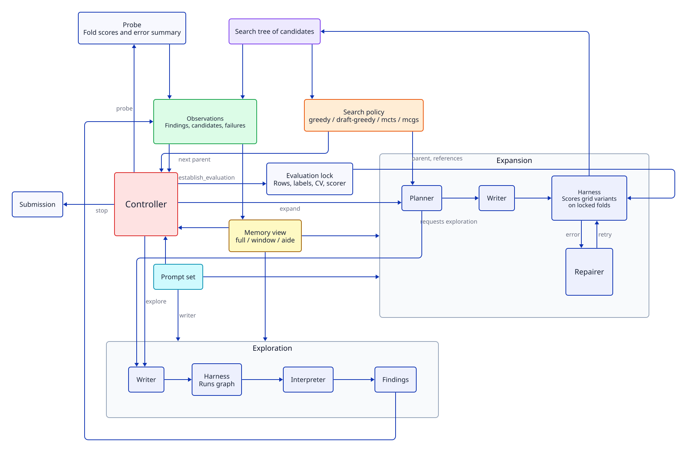

# nano-mle

A small, sequential harness for LLM-driven ML experimentation on tabular data.
A language model proposes data explorations, an evaluation setup and pipeline
experiments; the harness executes them, enforces budgets, locks the evaluation,
records every attempt and runs an interchangeable search policy (greedy,
draft-greedy, MCTS or MCGS) over the resulting candidates. An interchangeable memory
decides what each model call sees of the run's history. The controller can either
choose every action with an LLM or expand automatically after evaluation is locked.

All model-written code is expressed as [Skrub DataOps](https://skrub-data.org)
computation graphs: data reads, joins, aggregations, features and estimators are
recorded graph nodes rather than opaque Python functions. This makes every
exploration and pipeline inspectable and comparable, and keeps the evaluation
boundary checkable.

## Quick start

```bash
uv sync
uv run pytest       # offline test suite, 8 processes by default (each gets its own CPU slice)
```

## Running a task

1. **Describe the task** in a JSON file. Paths are relative to the file, or remote
   URIs such as `gs://bucket/table/`:

   ```json
   {
     "description": "Predict … Explain the entities, prediction setting, metric and data here.",
     "sources": {"train": "train.csv", "metadata": "metadata.csv"},
     "train_source": "train",
     "target": "target",
     "drop_columns": ["id"]
   }
   ```

   Only `description` and `sources` are required. `train_source`, `target` and
   `drop_columns` are hints; the model constructs the actual modelling population
   and labels.

2. **Configure credentials** in the repository `.env` (gitignored), for example
   `OPENAI_API_KEY=…`, `GEMINI_API_KEY=…`, and
   `GOOGLE_APPLICATION_CREDENTIALS=/path/key.json` for `gs://` sources. The model
   backend loads it when a run starts; workers inherit the environment.

3. **Initialise a workspace** (no model calls) and **run** it:

   ```bash
   uv run nano-mle init workspaces/my-run --task task.json --policy greedy --memory window \
     --max-model-calls 30 --max-expansions 3 --max-explorations 4 \
     --max-evaluations 8 --max-repairs 2 --execution-timeout 1800 --time-budget 8h
   uv run nano-mle run workspaces/my-run --model openai/gpt-6.1-sol
   uv run nano-mle show workspaces/my-run
   uv run nano-mle draw workspaces/my-run/artifacts/<step>/<attempt> > graph.svg
   ```

   `--model` is any DSPy/LiteLLM model id. `run` also takes `--max-tokens`
   (completion cap per call including reasoning, default 64,000; with high reasoning
   a lower cap cuts plans off mid-file, which then costs a repair) and
   `--request-timeout` (seconds, default 600; with high reasoning a long plan or repair
   can take over 3 minutes before the first byte). Provider retries are disabled; the
   harness asks once more itself, and both tries count as model calls. If a planner,
   writer, repairer or interpreter call gets no answer twice (timeout, connection,
   server or rate-limit error), its action fails and the run goes on; an unanswered
   repair leaves the attempt failed. An unanswered controller call ends the run as
   interrupted, so it can be resumed. The run
   ends with a [submission](#submission) of the best candidate unless `--no-submit`
   is given; put the prediction rows and the sample submission in the task's sources.

A run resumes where it stopped if `run` is invoked again on an interrupted
workspace; interrupted work stays recorded and is not replayed. A completed
workspace is immutable; use a new one for new budgets or evaluation rules.

## Configuration

Harness settings live in `nano-mle.toml` at the repository root. It is gitignored;
`nano-mle.example.toml` is the tracked template and holds the defaults, which apply
when no local file exists. `NANO_MLE_CONFIG` points to another file. Each run records
the configuration it used in its workspace metadata.

| Setting | Default | Effect |
|---|---|---|
| `[execution] cpu_threads` | 32 | Logical CPUs the workers may use; 0 means all. Workers are pinned to the first `cpu_threads` CPUs the runner may use, a hard cap even when a plan sets `n_jobs=-1`. OpenMP/BLAS thread counts are set to match. See [CPU setup](#cpu-setup-and-parallel-runs). |
| `[hardware] memory_gb`, `gpus` | 0, [] | What the agents are told about the machine (`context.hardware`, with `cpu_threads`): stated in the config, never probed, since with parallel runs the node holds more than one run may use. Keep `gpus` in line with what the run can see (`CUDA_VISIBLE_DEVICES`). 0 or [] means not stated. |
| `[execution] grid_n_jobs` | 1 | Fits run in parallel processes by the grid search; each gets `cpu_threads // grid_n_jobs` threads and its own copy of X and y, so values above 1 only pay off for small data. Probes fit sequentially with all threads. |
| `[plans] restrict_primitives` | false | Limit `apply_func` to the curated primitives in `graphs.PRIMITIVES`. Disabled for now, so plans may call any library function; plan-defined functions (other than `read_*` file readers) and lambdas are rejected either way. |
| `[memory.<name>] …` | memory defaults | Parameters of a memory, read at `init` (e.g. `[memory.window] leaderboard = 8`, `[memory.full] max_chars = 400000`). |
| `[policy.<name>] …` | policy defaults | Parameters saved at `init`: draft count, UCT exploration coefficient or MCGS seed. |
| `[models.<role>] model`, `reasoning_effort`, `max_tokens`, `timeout`, `api_base` | none: every role uses `--model` | A different model for one role: `controller`, `planner`, `writer`, `repairer`, `interpreter` or `summarizer`. Omitted keys come from the `run`/`submit` flags; a role given another model does not inherit `--reasoning-effort`. The run records the models per role in `model` and the config. |
| `[controller.auto] time_margin` | 1.0 | Auto stops when the remaining time is less than this factor times the longest of the last 3 expansions' worker time (repairs included). 0 disables the estimate. |
| `[prompts.<name>] …` | prompt-set defaults | Parameters of a [prompt set](#prompt-sets), read at `init`. The default set's `data_volume_study` (true) adds the data-volume-study convention for the planner and controller: for large sources, explore which rows and table parts are needed before the lock, and measure a learning curve over training-set size after it, unless the pool was already sized from a learned-model curve. The older `[prompts] data_volume_study` key still works. |

### Agent configurations

Controller, policy, memory and [prompt set](#prompt-sets) are independent choices set
at `init`. The default
remains `--controller llm --policy greedy --memory window`. For a new task,
`--policy draft-greedy` is recommended: greedy expands the first candidate's line for
the whole run, so the first model family tends to stay, while draft-greedy drafts
several pipelines from root first, which the conventions ask to differ in family. The LLM controller
chooses every action, including probes and explorations after the evaluation lock.
`--controller auto` uses the same LLM controller to prepare and lock evaluation,
then expands automatically. It supplies the planner with a direction to draft a
new, simple and different solution when the selected parent is root, or make one
measurable change when a candidate is selected.

An agent **profile** (`--profile NAME`, registry in `profiles.py`; `--preset` is
the older spelling) supplies default component choices. The `aide` profile selects
`auto`, `draft-greedy`, `aide` memory, and `--max-requested-explorations 0`. The
`mlevolve` profile selects `auto`, the `mlevolve` policy, the `experience` memory, the
`lean` prompt set, no explorations, no interpreter and the data overview:

```bash
uv run nano-mle init workspaces/aide-run --task task.json --profile aide \
  --max-expansions 20 --max-evaluations 80 --max-actions 40 --max-model-calls 160 \
  --execution-timeout 1800 --time-budget 8h
uv run nano-mle run workspaces/aide-run --model openai/gpt-6.1-sol
```

```bash
uv run nano-mle init workspaces/mlevolve-run --task task.json --profile mlevolve \
  --max-expansions 40 --max-evaluations 120 --max-actions 60 --max-model-calls 200 \
  --execution-timeout 1800 --time-budget 8h
```

Explicit flags override the profile regardless of their order. For example,
`--profile aide --memory window` compares memories, while
`--profile aide --controller llm --max-requested-explorations 2` lets the LLM choose
actions and permits the planner to request explorations inside an expansion.
Without a profile, that exploration limit defaults to 2, including with `auto`.
Other budgets retain their existing defaults and CLI controls.

Optional components are switched at `init` and recorded in the workspace
(`switches`); profiles may set them:

| Switch | Default | Off / on |
|---|---|---|
| `--planner` / `--no-planner` | on | Off: no planner call; the writer implements the operator's instruction and the controller's direction directly. |
| `--interpreter` / `--no-interpreter` | on | Off: explorations keep their outputs (memories show previews) but produce no findings. |
| `--data-overview` | off | On: at the first run start the harness summarises every source without model calls (schema, missing fractions, unique counts, numeric ranges and a head from the first 10,000 rows; row counts for Parquet; file counts for directories) and every role sees it as `data_overview`. |
| `--max-explorations 0` | 8 | No explorations; evaluation is locked without one. |

The controller sees `allowed_actions`, the actions the budgets and the lock permit.
An answer outside them is asked again once with the error (`previous_answer_error`),
like an answer that does not parse; a second one is rejected and counts as an action.

Set parameters in TOML, such as `[policy.draft-greedy] num_drafts = 5`,
`[policy.mcts] exploration = 1.414`, `[policy.mcgs] seed = 42`, and
`[memory.aide] explorations = 4`. The workspace records the resolved component
names and parameters, and the profile name only as information. Resume uses those saved settings;
changing TOML does not change them. Older workspaces retain the LLM controller and
the original policy defaults. `workspace.json` and the report expose the choices;
automatic decisions use the usual `controller_decision` journal events.

Auto stops at the expansion/evaluation limits, and can stop early using
`[controller.auto] time_margin`. The estimate is the longest worker time of the
last 3 expansions, repairs included, since expansions get slower as pipelines grow.
It excludes model calls, so it cannot guarantee the next expansion fits. With no expansion history, the first one is allowed; existing
worker timeouts still bound it. Action, model-call and wall-time budgets can end a
run before its expansion limit.

#### Profile fidelity

Each profile reproduces its agent's search and memory mechanisms; every profile
shares the Skrub plans, the harness-locked evaluation (one setup, locked before the
search, instead of a split written by each solution), the inner repair loop and
sequential execution. Accurate wording is "the agent's mechanisms, adapted", not a
reimplementation.

**`aide`**, after the [AIDE paper](https://arxiv.org/html/2502.13138v1) and its code
(`aide/agent.py`):

| AIDE | nano-mle |
|---|---|
| Data preview, "Don't suggest to do EDA" | `--data-overview`, no explorations, no interpreter |
| Draft until 5 drafts (failed ones count) | `aide` policy, `num_drafts = 5` |
| With probability 0.5, debug a random buggy leaf with debug depth <= 3 | `debug_prob = 0.5`, `max_debug_depth = 3`, `debug` operator; the inner repairs run first |
| Otherwise improve the best node; draft when none is good | same (`improve`, `draft`) |
| One call writes a 3-5 sentence plan and the code | no planner; the writer's module docstring becomes the candidate's description |
| Draft: simple, no ensembling or tuning, different from memory; improve: one atomic change | `draft` and `improve` operator instructions, `lean` prompts |
| Memory: design, results and metric of every good node | `aide` memory: description, configuration and score of every valid candidate, plus failed drafts |
| An LLM review reads the output: bug flag, metric, summary | omitted: the harness scores on the locked folds and knows failures from errors |
| Each solution writes a hold-out or 5-fold evaluation | the locked evaluation |

Grids create several candidates per expansion, so choose an evaluation budget large
enough for them.

**`mlevolve`**, after the [MLEvolve paper](https://arxiv.org/html/2606.06473) and its
code: see the `mlevolve` policy under [Search](#search), the `experience` memory, and
the mapping table in [docs/meta-harness-plan.md](docs/meta-harness-plan.md) (Phase 2).
Adapted or omitted: embedding retrieval (lexical only), forced backpropagation,
the cold-start knowledge base, the code-review and leakage agents, diff-mode code
edits, parallel workers.

**`fm-agent`**, after the [FM Agent paper](https://arxiv.org/html/2510.26144). The
paper describes the mechanisms but gives no parameters, prompts or code, so the
numbers are ours:

| FM Agent | nano-mle |
|---|---|
| Cold start: parallel generation agents with different directions | `num_islands * drafts_per_island` drafts (3 × 1), each told to differ from the others |
| Islands, partitioned by similarity, evolving mostly independently | `islands` policy: drafts assigned in turn, islands evolved in turn, a child joins its parent's island |
| Adaptive, cluster-based sampling by semantic and structural diversity | rank sampling with weights exp(-β·rank), β from 0.1 to 1.5 with the island's mean Jaccard distance of description, configuration and block tokens; no clustering |
| Mutation and crossover | `mutate` (elite pool as inspiration), `crossover` with probability 0.3 (parent + another island's elite) |
| Periodic interaction between islands | migration every 6 expansions: each island's best joins the next island |
| Elite pool | the 5 best valid candidates |
| Adaptive model fusion (ensembles, stacking) for ML tasks | `ensemble` operator after 75 % of the run, probability 0.25, at most 2 |
| Evaluator with LLM-judge feedback; human feedback module; RAG knowledge | omitted (knowledge: TODO) |
| Ray-distributed workers | sequential |

### Prompt sets

The instructions of the controller, planner, writer and repairer come from a prompt
set, chosen like the other components at `init --prompts NAME` (default: `default`)
with parameters from `[prompts.NAME]`. A set is a class of named fragments (`goal`,
the `conventions` dict of rules, `control_texts` with shorter controller versions of
some of them, `control_rules`, `planning_rules`, `writer_rules`, `guide_notes`), and
its methods assemble each role's instructions from them, so a
changed rule reaches every role that uses it. A variant subclasses a set, overrides
what it changes and is registered in `prompts.PROMPTS`:

```python
class NoModelGuidance(Prompts):
    name = "no-model-guidance"
    conventions = {k: v for k, v in Prompts.conventions.items() if k != "model_families"}

PROMPTS["no-model-guidance"] = NoModelGuidance
```

The plan contract (`plans.GUIDE`) is enforced by the harness and stays the same in
every set; a set may add `guide_notes` after it. The workspace records the set's name
and parameters, and at every run start the rendered texts (`prompt_texts`) and their
hashes (in the `run_started` event), since the code of a set may change between runs.

Registered sets:

| Set | Instructions |
|---|---|
| `default` | The current conventions. |
| `oct04` | The default set as of 2026-10-04, frozen for ablations: population filters compared only when the check shows a difference, no threshold; no training-objective convention; the controller sees the full model conventions and may name methods, which the planner follows; a plateau may end the run. |
| `lean` | For runs without explorations: the controller locks evaluation from the task, the sources and the data overview; the population check and the pool size become audit outputs of the setup; proposals state the change, why, the evidence and what stays unchanged, with a larger change on a plateau (after MLEvolve). |
| `oct09` | The default set as of 2026-10-09 (third APTOS round), frozen for ablations: population check preferring the least restrictive rule, weighing lower AUC against lost training rows and normalising recording differences instead of dropping rows; frozen and fine-tuned pretrained models count as different families; the planner lists reused candidates in `reference_ids`. |

### CPU setup and parallel runs

Two layers decide where plan code runs:

1. **How the runner is started.** A process may run on a set of CPUs (its affinity),
   and children inherit it. Plain `uv run nano-mle run …` may use all CPUs;
   `taskset -c <cpus> uv run nano-mle run …` restricts the runner and everything it
   starts.
2. **The harness.** Each attempt runs in a worker subprocess pinned to the first
   `cpu_threads` CPUs of that set (`execution.allowed_cores`, `pin`), with OpenMP and
   BLAS thread counts set to match. The runner itself is not pinned; it mostly waits
   on model calls.

Set `cpu_threads` to the number of **physical cores** in the set. On a machine with
two threads per core (check `lscpu` and
`/sys/devices/system/cpu/cpu0/topology/thread_siblings_list`), two threads on one
core share its arithmetic units and cache. LightGBM, XGBoost, BLAS and PyTorch gain
little from the second thread; LightGBM's documentation recommends the physical core
count. Never give workers more threads than CPUs: OpenMP threads wait for each other
at every step, so one descheduled thread stalls all of them (two runs sharing 32
CPUs made LightGBM about 30× slower).

Example machine: 64 logical CPUs, 2 sockets, 16 cores per socket, 2 threads per core.
CPUs 0–31 are the first thread of each core, and 32–63 their siblings (0 and 32 share
a core). Socket 0 holds 0–15 and 32–47, socket 1 holds 16–31 and 48–63.

| Setup | Start | `cpu_threads` | Workers use |
|---|---|---|---|
| One run (recommended) | `uv run nano-mle run …` | 32 | 0–31: one thread on every core |
| Two runs, one per socket | `taskset -c 0-15,32-47 uv run nano-mle run …` and `taskset -c 16-31,48-63 uv run nano-mle run …` | 16 | 0–15 and 16–31: one thread per core, memory local to the socket |
| Two runs without `taskset` | — | any | the same first CPUs: they share cores and stall each other |

Runs are normally sequential; the harness does not coordinate CPUs between runs.
Start parallel runs with `taskset`, as above. If they need different settings, give
each its own config file via `NANO_MLE_CONFIG`. A run with fewer cores gets less done
within a time budget, so compare runs only on the same core layout.

## Submission

A run ends with a submission, like mle-claude's ml-submit skill: once the search stops
(by the controller, a budget or the time limit), the runner refits the best candidate
and writes the prediction file. `run --no-submit` skips it; `--submit-timeout`
(default 7200 s) bounds its fit and predict. The submission runs outside the time and
model-call budgets, and a failed submission leaves the run complete. Running a
completed workspace again submits only if no submission succeeded yet.
`nano-mle submit WORKSPACE --model MODEL [--candidate ID] [--task TASK.json]` does the
same on its own, e.g. for another candidate or an updated task file.

The harness takes the best candidate (or the named one) and resolves its winning grid
variant. One writer call (with repairs) re-roots the plan so it can be applied to new
rows. Rows that differ between fitting and predicting are read through `skrub.var`
holding a path, bound by the plan's `FIT` and `PREDICT` dicts. When they come from
different sources or formats, the plan reads both and selects them with
`skrub.eval_mode().skb.match({'predict': predict_rows}, default=fit_rows)`, leaving
`FIT` and `PREDICT` empty. The harness fits once, predicts, checks columns, keys and
row count against `FORMAT` (the sample submission) and writes
`submission/<id>/attempt_*/submission.csv`, or `.tsv` when the plan sets
`OUTPUT_SEP = '\t'` and has no format file. The writer sees the first lines of each
text source and a note on turning per-row predictions into long top-k tables.
`--task` passes an updated task file that adds the prediction rows and the sample
submission as sources. Submissions are never scored and never become candidates.

A writer answer that cannot be used (unparseable, or the provider gives none) is
asked for again once; if that fails too, it costs one attempt and the next attempt
re-implements or repairs. Repairs see the full traceback.

## How a run works



[PNG for terminal viewing](docs/diagrams/run-flow.png) ·
[D2 source](docs/diagrams/run-flow.d2) ·
[Regeneration instructions](docs/diagrams/README.md)

The [proposed configurable system](docs/diagrams/configurable-system.svg) extends
this flow with three data-understanding modes, optional components, explicit
experiment operations and resumable refinement or population workflows. It is a
design proposal; the diagram above describes the current implementation.
An [annotated version](docs/diagrams/configurable-system-agents.svg) maps components
to the proposed mle-claude, AIDE, MLEvolve, MLE-STAR and FM-Agent profiles.

Before the evaluation lock, the controller, planner and writer are asked for a
population check: labelled rows may be selected differently from the rows to be
predicted, also on label-related properties the prediction rows do not show. They
compare candidate populations with the prediction rows on label-free observables,
including an adversarial classifier (ROC AUC near 0.5 means indistinguishable; above
about 0.55 counts as a difference). They always compare populations given by
plausible selection rules, including filters on label-derived quantities and
one-sided thresholds as well as bands, lock the one with the lowest AUC (the least
restrictive among those within fold noise of it) and report every compared AUC in
the setup. The setup does not restrict which labels later pipelines use: labelled
rows outside the population stay available. The locked rows
are also the training rows, and every experiment fits all folds on them. A quick
learning curve before the lock, with a learned model (not priors or heuristics),
sizes the population: each size is timed as an experiment runs it (features and
model on every fold), and the pool is the largest size that still leaves time for a
dozen or more experiments, larger only when the gain beats a typical modelling
change. That size is a limit extrapolated from the measured times, not a target.

Model choice follows conventions shared by the controller and planner: compare model
families before tuning one, with at least one that learns its parameters from the
data (on the GPU when `context.hardware` lists one); prefer learned over hand-set
weights; train on a loss that rewards what the metric rewards; after two expansions
within the fold noise, switch family, objective or signal instead of sweeping
again, and do not stop on a plateau while an expansion still fits in the time
left. The controller states the goal of an expansion and its evidence and never
names a method; it sees shorter versions of the model conventions without
methods. The planner chooses the method and treats one named in the direction as
an option; once a candidate combines several feature blocks, it may ablate them
one at a time.

The conventions are task-independent: examples in them must not hint at a
particular task's solution. Prompts are tuned on runs of specific tasks, so a
change motivated by one run is phrased as the general principle.

A single loop dispatches one controller decision at a time:

| Action | What happens | Scored? |
|---|---|---|
| `explore` | The writer produces a graph answering a concrete question; outputs are evaluated and an interpreter turns them into scoped findings. It may fit models for quick evidence, but never produces candidates. | No |
| `establish_evaluation` | The writer constructs the modelling population, raw labels, CV and scorer. The harness audits and locks them. Needs a successful exploration unless explorations are off. | No |
| `expand` | An [operator](#operators) names the kind of experiment. The search policy selects a parent (peeked before the controller call, so the controller's reason is written for it); the planner proposes a bounded change (or requests an exploration first); the writer implements it; every grid variant is scored and becomes its own candidate (`<expansion>_variant_N`, shown as v1, v2, …), which later expansions can select as a parent with its grid values resolved. | Yes |
| `probe` | Reports, for an existing candidate, the out-of-fold predictions kept when it was scored (fitting it again only if none were kept), or fits a pipeline the writer builds on the locked folds; reports its fold scores and a harness-computed error summary of its out-of-fold predictions. | No |
| `stop` | Ends the run. | |

Who decides what, compared with a single-agent harness such as mle-claude:

| Decision | mle-claude | nano-mle |
|---|---|---|
| Next action (explore, lock evaluation, expand, probe, stop) | LLM | LLM controller, or auto after the lock |
| Which candidate to build on | LLM | search policy (greedy / draft-greedy / MCTS / MCGS); the controller sees its pick before deciding |
| What to change in the experiment | LLM | LLM planner, given the selected node and the controller's reason for expanding |
| Writing and fixing code | LLM | LLM writer / repairer |
| Turning outputs into findings | LLM | LLM interpreter |
| Scoring and the evaluation lock | harness | harness |

Who knows what. mle-claude is one agent with one continuous context; nano-mle's roles
are stateless calls that see what the harness passes them:

| Knowledge | mle-claude | nano-mle |
|---|---|---|
| Task description and sources | the agent | every role (task and source manifest) |
| Raw data | read directly, any slice | only through a plan's graph, evaluated by the harness |
| Exploration results | everything it printed | output previews of the last four explorations, plus the interpreter's scoped findings |
| Earlier code | any file in the workspace | writer sees the parent's and references' resolved source |
| Model errors | loads out-of-fold predictions and slices freely | probe fold scores, preview and a harness-computed error summary |
| Intermediate artifacts | reads its own files (convention: no cached features) | never: plans read task sources only, artifact paths are hidden |
| History and reasoning | its own context window | what the [memory](#memory) shows: by default findings, leaderboard, recent explorations and failures, trajectory |
| Run time | sees wall time | attempt wall time, phase timings and per-variant fit times in the records it is shown |
| Hardware | can inspect the machine | `context.hardware` from `[hardware]` and `cpu_threads` in the config; never probed |

Every implementation runs in a time-bounded subprocess. If it fails, the repairer
gets the source and traceback and may fix it, up to `--max-repairs` times. A repair is
not started when less run time remains than the median attempt of that kind in this
run (event `repair_skipped`). The writer and repairer see the selected parent's
source and the references' source; the planner adds a candidate as a reference by
listing it in its proposal's `reference_ids`, e.g. a draft from root that reuses an
earlier candidate's components. A
repair must keep the planned experiment; a different hypothesis needs a new proposal.

Budgets cover controller actions, model calls (counted before dispatch, including
failures), explorations, setup attempts, expansions, scored variants, probes, repairs,
per-attempt execution time and, with `--time-budget`, end-to-end run time. They bound
call volume and time, not dollar cost.

**Time budget.** Elapsed time is summed over the run's sessions; time while a run is
stopped does not count. The run stops once the budget is spent, and no attempt may run
past it: its timeout is the smaller of `--execution-timeout` and the remaining time.
The controller and planner see `context.time` (budget, elapsed and remaining seconds,
and the median attempt duration per kind in this run) and are asked to choose and size
actions that fit.

## Memory

The journal (`state.db`) holds the complete history. A memory decides which part of
it each model call sees, so it can be swapped like the search policy:

```python
class Memory(Protocol):
    name: str
    ask: Callable[[dict, str], str] | None   # bound by the runner

    def view(self, role, journal, query=None, parent_id=None) -> dict: ...
    def observe(self, kind, record) -> None: ...
```

| Rule | Why |
|---|---|
| Every role goes through `view`: controller, planner, writer, repairer, interpreter | one place decides what the model sees |
| Each role brings a query: none for the controller, the controller's direction for the planner, the intent for the writer, the error for the repairer, the question for the interpreter | stage-aware retrieval becomes possible (e.g. similar past errors for the repairer) |
| The harness adds the fixed parts (task, contract, budgets, counts, time, selected parent and references) and strips artifact paths after the view | a memory cannot hide the budget or expose earlier outputs |
| `journal` is read-only; derived state (an index, summaries) must be rebuildable from it, fed by `observe` after each record write | resume works as for search policies |
| `ask(context, instruction)` runs a journaled `summarize` call counted against `--max-model-calls` | a memory's own model use shows up in the budget |
| Chosen at `init --memory <name>`, parameters from `[memory.<name>]` in `nano-mle.toml`, recorded in the workspace | the memory is an experimental variable, fixed for a run |

| Memory | View |
|---|---|
| `window` (default) | the best 8 candidates, the last 4 explorations with their output previews, the last 4 failures, all active findings, all probe outputs, the parent's last 6 ancestors |
| `full` | everything recorded: all candidates, failures, explorations, findings (superseded ones flagged), probes and the whole lineage, up to `max_chars` of JSON (default 400,000); beyond it the oldest explorations, then the oldest failures, then the lowest-ranked candidates are omitted and counted |
| `aide` | `solutions`: every valid candidate's id, parent, description, configuration description and score, in creation order (not ranked); `failed_drafts`: failed root expansions with their proposal and error; active findings, the last 4 exploration previews and probe outputs preserve evidence for evaluation preparation or an LLM controller. No candidate code, other failures or ancestry are included; the harness still supplies the selected parent's source and current repair traceback. Candidate summaries grow with the run. |
| `experience` | MLEvolve's memory: `siblings` (the selected parent's other children, or the drafts, with their outcome against the parent: label +1/0/−1, or the error), the best 5 candidates, findings and probe outputs; for the planner `similar_experiments` (2 improved and 2 worse experiments retrieved by BM25 with the controller's direction and the parent's description), for the repairer `similar_errors` (2 errors a later attempt fixed, with the fix's code diff, or a debug expansion fixed). Lexical retrieval only; MLEvolve also uses embeddings. |

With `window`, the context grows early and then levels off; only findings grow
without bound.
Example: a control call of a 4 h Gemini forest-cover run, after 8 expansions:

| Part | Size | Bound |
|---|---|---|
| Recent explorations (with their output previews) | 20 KB | last 4 |
| Leaderboard (configurations, fold scores) | 17 KB | top 8 |
| Task description | 6.5 KB | fixed |
| Findings | 4 KB | all active (superseded ones dropped) |
| Probe outputs (summary, preview) | 2.7 KB | probe budget |
| Locked evaluation source | 1.5 KB | fixed |
| Next parent, time, budgets, counts, sources | 2.5 KB | fixed |

Over that run the context went 7 KB (first call) → 34 KB (evaluation locked) →
51 KB (after 3 expansions) → 55 KB (after 8), about 14k tokens (estimated at 4
characters per token). The dashboard plots this per control call, stacked by part.

Each model call also records the provider's exact token usage (input, output,
reasoning, cached) and its cost, as LiteLLM reports them for any model; cost is
empty for a model missing from LiteLLM's price table. The record is the call's
`usage` in the journal. The dashboard switches the context chart to exact input
tokens and lists tokens and cost per role.

## Plans

Every plan is standalone Python with imports, optional graph-building helpers and
one zero-argument `build()`. Graphs are built lazily; the harness evaluates them.

**Exploration** returns named DataOps. They are evaluated together in a single
graph evaluation, so shared reads and transformations run once:

```python
import pandas as pd
import skrub

def build():
    data = skrub.as_data_op("train.csv").skb.apply_func(pd.read_csv)
    return {"missing_counts": data.isna().sum(), "summary": data.describe()}
```

**Evaluation setup** marks X and the raw y as soon as population and labels exist,
attaches an explicit deterministic CV, and names a scikit-learn scorer. It may also
return `row_keys` (unique, aligned) and `audit` (named DataOps saved as evidence).
Joins, filters, derived labels, custom splitter classes and split kwargs are allowed:

```python
from sklearn.model_selection import KFold

def build():
    data = skrub.as_data_op("train.csv").skb.apply_func(pd.read_csv)
    X = data.drop(columns=["target"]).skb.mark_as_X(
        cv=KFold(3, shuffle=True, random_state=42), split_kwargs={})
    y = data["target"].skb.mark_as_y()
    return {"X": X, "y": y, "scoring": "neg_root_mean_squared_error"}
```

**Pipelines** receive the locked setup as source code defining `build_evaluation()`.
The harness runs it before the plan in the same module, so a pipeline calls it and
uses the setup's imports, constants and functions without pasting them (writers
copying the setup used to corrupt it), and builds features and models downstream.
Final plans are self-contained: their writer gets the setup and the candidate as one
program. A named `skrub.choose_from` grid
becomes one candidate per variant:

```python
from sklearn.linear_model import Ridge

def build():
    setup = build_evaluation()
    encoded = setup["X"].skb.apply(skrub.TableVectorizer())
    model = Ridge(alpha=skrub.choose_from([0.1, 10.0], name="alpha"))
    pred = encoded.skb.apply(model, y=setup["y"]).skb.set_name("model")
    return {"pred": pred, "scoring": setup["scoring"]}
```

**Named blocks.** Pipelines name the last step of each feature block and the model
(which is `pred`) with `.skb.set_name`. The harness rejects a pipeline whose `pred`
is unnamed and records each candidate's blocks (`blocks`, in graph order), so
operators and memories can refer to components. Names are not part of the
fingerprints, so naming never drifts the evaluation contract.

**Scoring.** The setup's `scoring` is either a scikit-learn scorer string or a plain
function `scorer(estimator, X, y) -> float` defined in the setup (higher is better).
It runs on each test fold with that fold's marked X, so ids and group keys kept in X
can drive grouped metrics such as per-entity recall@k. A custom scorer is locked like
a custom splitter: by its source plus the plan helpers and upper-case constants it uses.

**Probes.** A probe is written like a pipeline with a single configuration. The
harness wraps the locked scorer to capture each test fold's predictions during the
normal fold loop, so nothing is fitted twice, and writes `oof_predictions.parquet`
with `row` (position in the locked X), `fold`, `y`, `prediction` (positive-class
probability, or the predicted label plus one `proba_<class>` column per class) and
`row_key` (one `row_key_<column>` per column for multi-column keys). Every
candidate keeps the same file per variant (`oof_predictions_<variant>.parquet`)
when its folds are scored sequentially (`grid_n_jobs = 1`), so a probe of a
candidate reuses it instead of fitting again; only a probe of a new pipeline fits.
Failed probes reach the controller with their error (`failed_probes`), so it does
not ask the same probe again. The file is for people and the dashboard. The model sees the fold scores,
a preview and an error summary computed by the harness: per-class recall, precision
and confusion for classification, calibration by prediction decile for binary
probabilities, error quantiles for regression.

**Plan rules.** These are enforced by a source lint (`plans.py`) and a runtime graph
check (`graphs.py`):
- Readers are recorded with `skrub.as_data_op(path).skb.apply_func(pd.read_csv | pd.read_parquet, ...)`.
- Plans read only the task sources. Every path or URL in a plan's graph must be a
  source or lie inside a source directory; files written by earlier steps (outputs,
  predictions, manifests) are rejected, so anything worth reusing is recomputed. The
  model context lists task sources but no artifact paths.
- Computation is expressed as fine-grained DataOps. No UDFs, `deferred`, callable
  `apply`/`map`, eager reads (pandas, polars, pyarrow or numpy file readers),
  materialised data, files, or manual fitting in the graph.
- Files no library reader handles (images, audio, documents) are read by a
  plan-defined function named `read_*`, applied with `paths.skb.apply_func(read_x, ...)`.
  It is the only plan function allowed in the graph, is fingerprinted by its source,
  and should only read and decode; everything after it is DataOps.
- Plans keep no state between fits: no module-level caches, `global`, or mutable class
  attributes. Module constants such as paths and the `FIT`/`PREDICT` dicts are fine.
- Custom classes are allowed when they are estimators or transformers (`fit`), torch
  modules (`forward`) or CV splitters, applied with `.skb.apply`. Inside them, fitting,
  private state, `super().__init__()`, setting attributes of other objects (torch flags
  such as `p.requires_grad`) and `print` are allowed. The guide asks for them only
  when a step needs fitted state or is a new model. A plan-defined class inside the
  locked X/y graph is fingerprinted by its source.
- Any installed library may be imported, including lightgbm, xgboost, catboost, torch
  (CUDA), skorch, sentence-transformers, polars, faiss and rank_bm25. Modules that
  reach processes, files, the network or interpreter internals are denied.
- The harness never installs packages. An import of a missing library fails the
  attempt and is recorded in `missing_libraries.json` at the repository root (also
  shown in the dashboard), so you can decide what to add.

These checks enforce the plan style. They are not a security sandbox or a proof of
no leakage.

## Evaluation lock

When a setup passes its audit, the harness locks a contract with these parts:
- the structural fingerprints of the X, y, CV/split-kwargs, scorer and row-key graphs;
- the row count;
- the exact positional fold memberships.

**Fingerprints.** They ignore Skrub UUIDs and variable names, so an equivalent graph
constructed independently is accepted. The comparison is structural, not a proof of
semantic equivalence.

**Checks on every pipeline.** Before fitting, the pipeline's boundary is
re-fingerprinted and re-evaluated, and the folds are re-derived and compared with
the lock.

**Drift.** If any part drifts, the attempt is sent back for repair. If the drift is
not repaired, no candidate or search reward is created. A run has exactly one
evaluation setup; a different one needs a new workspace.

**Inputs are assumed frozen.** Source contents and remote object versions are not
hashed. Hashes protect the generated artifacts and the contract itself.

## Search

Candidates are search nodes; explorations and findings are evidence and carry no reward.

**Policies.**
- `greedy` expands the best valid candidate.
- `draft-greedy` selects root for the first `num_drafts` expansion attempts (default
  5), then expands the best valid candidate, returning to root if none is valid.
  Failures, including planner failures without candidates, count. A grid counts as
  one expansion, regardless of how many variants it produces.
- `mcts` uses UCT with progressive widening.
- `mcgs` adds an elite-selection schedule and passes cross-branch candidates to the
  planner as references.

- `mlevolve` follows [MLEvolve](https://arxiv.org/html/2606.06473)'s progressive
  MCGS: UCT with a decaying exploration constant; a switch from UCT to elite top-K
  selection between 50 % and 70 % of the run; child limits (5 drafts, 3 improvements,
  1 debug); improvement chains that continue from the newest candidate and
  backpropagate (−1 failed, 1 valid, 2 new branch best) only when the chain ends;
  and the operator per expansion: `draft`, `debug` for a failed candidate, `evolve`
  or later `fuse` on a stagnant branch, `aggregate` at a full root under global
  stagnation, `improve` otherwise. Its parameters are in `[policy.mlevolve]`; the
  module docstring of `mlevolve.py` lists what is adapted.

- `islands` follows [FM Agent](https://arxiv.org/html/2510.26144)'s island evolution:
  a cold start of one draft per island, islands evolved in turn, rank sampling whose
  pressure grows with the island's diversity, `crossover` with another island's
  elite, otherwise `mutate`, migration of each island's best to the next, and late
  `ensemble` fusion. Parameters in `[policy.islands]`; see `fm.py`.

`mcgs` is an earlier, smaller sketch of MLEvolve, kept for existing workspaces.

**Rewards.** Every scored variant is one observation:
- −1 for a failure;
- +1 for a valid non-improvement;
- +2 for an improvement over the best score before the batch.

The reward is backpropagated along the parent chain. Variants of one grid are
siblings under the same parent.

## Operators

Every expansion runs the same pipeline (planner, Skrub writer, inner repairs, harness
scoring). Its operator (`operators.py`, named in the decision's `operator`) adds an
instruction for the planner and writer (`context.operator`), extra context, whether
its candidates may become parents, and an update of the run's `workflow_state`,
which is committed in the same transaction as the candidates, so resume is exact.
Policies read that state but never change it. Candidates record `operator`,
`contributor_ids` (other candidates an operator combines; rewards still follow the
parent) and `selectable` (diagnostic variants such as ablations are scored but never
selected or submitted).

| Operator | Parent | Used by |
|---|---|---|
| `free` | any | the LLM controller: the controller's reason describes the experiment |
| `draft` | root | `auto`: a new, simple solution, different from the existing drafts |
| `improve` | a candidate | `auto`: one measurable change to the parent |
| `evolve` | a candidate | `mlevolve` on a stagnant branch: a change supported by the branch's trajectory (`context.evolution`); a larger change on a plateau |
| `fuse` | a candidate | `mlevolve` on a stagnant branch after half the run: adopt one technique from other branches' best candidates (references) |
| `aggregate` | root | `mlevolve` under global stagnation: a new pipeline from the best candidate of each branch (`context.aggregation`) |
| `debug` | a failed candidate | `mlevolve`, `aide`: a minimal fix of a failure the inner repairs left (`context.debug`) |
| `mutate` | a candidate | `islands`: one change, the elite pool as inspiration (references) |
| `crossover` | a candidate | `islands`: a child of the parent and another island's elite (reference), combining named blocks |
| `ensemble` | a candidate | `islands`, late in the run: one plan that rebuilds the parent's and the references' models and combines their predictions; every member is refitted |

A policy may name the operator in its selection; `auto` follows it, and the LLM
controller sees it in `next_expansion_parent`.

Further operators and profiles for other agents are planned in
[docs/meta-harness-plan.md](docs/meta-harness-plan.md).

## Workspace

```
state.db         authoritative journal: metadata, records and events (SQLite)
workspace.json   task, sources, budget, policy, memory, model, state and evaluation contract
graph.json       candidates with parent, reference and evidence edges, search statistics
report.md        leaderboard, evaluation audit, drift warnings and findings
artifacts/
  calls/                         every model call's inputs and outputs
  <exploration|setup|expansion>_<id>/<attempt>/
    plan.py, request.json, response.json, execution.log
    *.graph.json, *.steps.txt    DataOps graphs (nodes, arguments, dependencies)
    *.csv / *.npy                full exploration and audit outputs
    timings.json                 per-phase time breakdown, updated while running
```

**`timings.json` phases.** It records imports, request loading, contract
verification, lazy graph building, boundary fingerprinting, X/y evaluation and
checks, graph export, learner/grid construction and grid search. The grid search is
split into fold fitting, fold scoring and search overhead. A worker that times out
still shows which phase was running.

## Code map

| File | Role |
|---|---|
| `cli.py` | Entry point: `init`, `run`, `submit`, `show`, `draw`. |
| `runner.py` | Controller loop, budgets, repair loop, exploration/setup/expansion, report export, resume. |
| `controllers.py` | LLM and automatic next-action strategies. |
| `operators.py` | Experiment operators: instruction, parent rule, selectability, workflow-state update. |
| `profiles.py` | Agent profiles: named default component choices. |
| `overview.py` | Static data overview of the task sources, computed by the harness. |
| `memory.py` | Memory protocol, read-only journal view, `window` and `full` memories. |
| `agents.py` | DSPy backend: controller, planner, writer, repairer and interpreter signatures. |
| `prompts.py` | Prompt sets: named fragments assembled into the controller, planner, writer and repairer instructions; registry of variants. |
| `plans.py` | Plan guide shown to the writer, source lint, locked-setup export, grid-variant resolution. |
| `models.py` | Pydantic types: task, decisions, proposals, findings, budget. |
| `execution.py` | Runs one plan in a killable subprocess with a timeout. |
| `worker.py` | Subprocess body: builds the graph, evaluates outputs, audits the boundary, runs the grid search, records timings. |
| `evaluation.py` | Evaluation-boundary audit: X/y/CV/row-key checks, folds, drift detection. |
| `graphs.py` | Runtime graph rules and structural fingerprints (the only private-Skrub-API use besides the graph export). |
| `contracts.py` | Contract creation, hashing and drift comparison. |
| `search.py` | Greedy, MCTS and MCGS policies and reward updates. |
| `store.py` | SQLite journal. |
| `config.py` | Loads `nano-mle.toml` (threads, grid parallelism, plan checks). |
| `timing.py` | Phase timer for workers. |
| `libraries.py` | Repository-level record of imported-but-missing libraries. |
| `submit.py` | Final refit of a candidate, prediction on new rows, format checks; used at the end of a run and by `nano-mle submit`. |
| `draw.py` | `nano-mle draw ATTEMPT`: rebuilds a recorded plan lazily and prints its Skrub `draw_graph` SVG. |

`dashboard/` is an optional, harness-agnostic web UI for browsing runs, search trees
and launching new runs (see its README). `FUTURE_IDEAS.md` collects design notes that
are not implemented, such as multiple evaluation branches.

## Limitations

- **Execution:** sequential throughout, with one evaluation setup per workspace.
  There is no intermediate caching: shared reads are recomputed across attempts,
  and inside the grid search for every fold.
- **Data access:** only CSV and Parquet readers are supported; local and `gs://`
  paths work with the installed `gcsfs`/`pyarrow`. Shell access, plots, and final
  refitting or submission files are out of scope.
- **Trust:** generated code is trusted. Workers are timeout-bounded subprocesses,
  not a sandbox.
