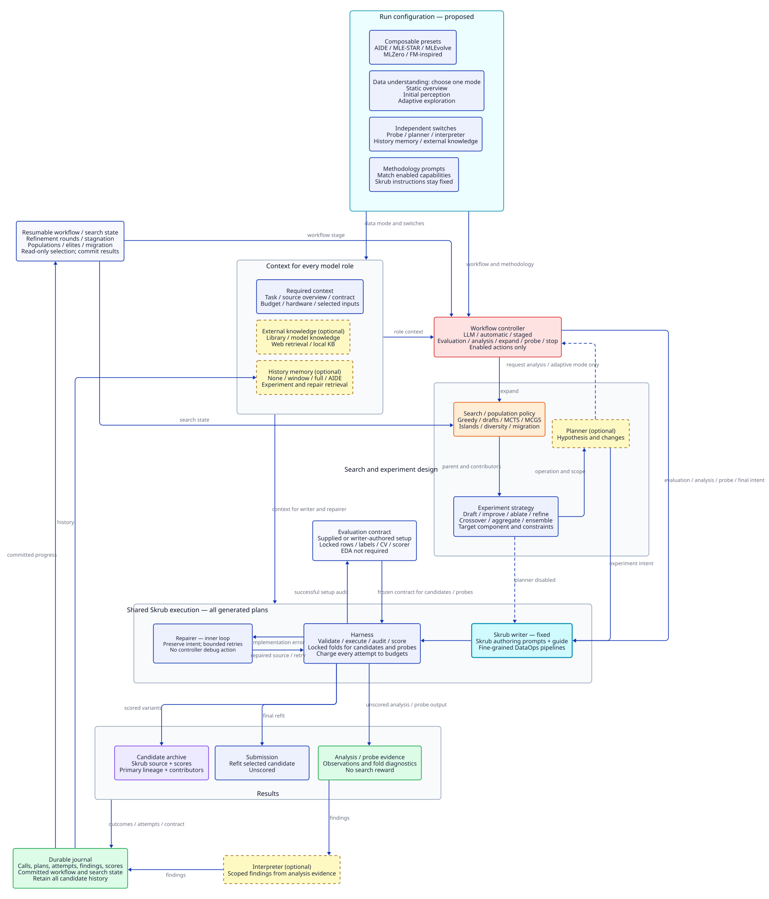
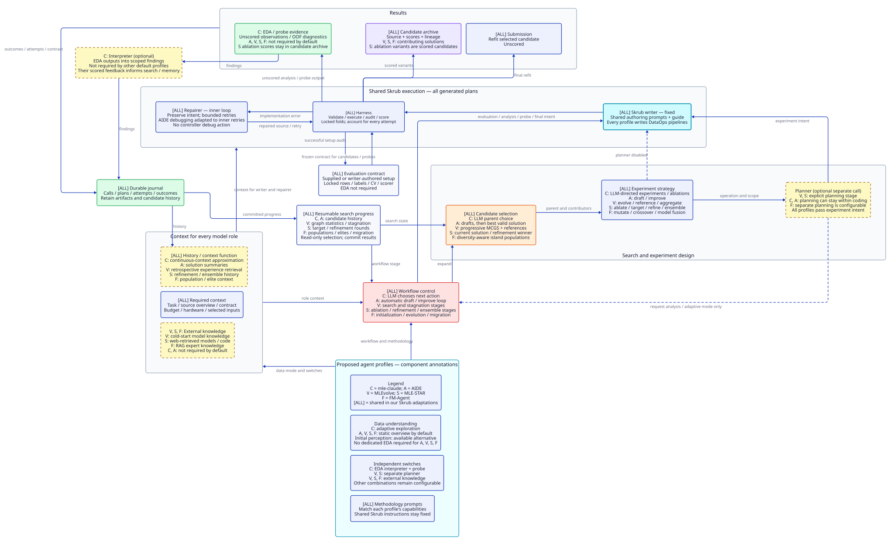

# Diagrams

Requires [D2](https://d2lang.com/tour/install/) v0.9.0 or newer on PATH.
Uses the bundled TALA layout engine and built-in PNG renderer.

`run-flow` describes the current implementation. `configurable-system` describes
the proposed system; its presets and additional components are not implemented.
`configurable-system-agents` annotates the same proposed components and connections
for mle-claude, AIDE, MLEvolve, MLE-STAR and FM-Agent.



[Proposed D2 source](configurable-system.d2) ·
[Proposed PNG](configurable-system.png) ·
[Current run flow](run-flow.svg)



[Annotated D2 source](configurable-system-agents.d2) ·
[Annotated PNG](configurable-system-agents.png)

Edit a `.d2` source, then regenerate the checked-in SVG and PNG exports from the
repository root. With no arguments, the script renders all three diagrams:

```bash
bash docs/diagrams/render.sh
```

To regenerate just one version:

```bash
bash docs/diagrams/render.sh configurable-system
bash docs/diagrams/render.sh configurable-system-agents
```

Preview the PNG in kitty:

```bash
kitten icat docs/diagrams/run-flow.png
kitten icat docs/diagrams/configurable-system.png
kitten icat docs/diagrams/configurable-system-agents.png
```

The READMEs embed SVGs for sharp browser rendering. Each PNG has an opaque
white background for consistent terminal display. Commit the source and both
exports together after editing the diagram.

The flow preserves the controller actions, exploration and expansion stages,
evaluation lock, candidate feedback, policy, memory and prompt connections.
Available policies and memories are listed inside their respective boxes.

The proposed version separates workflow control, candidate selection, experiment
operations and planning. Data understanding has three modes: a static overview,
initial perception, or adaptive exploration. Generated perception and exploration
plans use the same Skrub writer and execution path as other plans; static overview
metadata may be supplied or produced by the harness. Initial perception ends
before candidate search; adaptive mode allows later analysis requests. Probes are
independently optional. Evaluation preparation can use supplied setup code or a
writer-authored plan and still audits and locks the contract without requiring EDA.

Dashed boxes identify components that can be switched off; dashed arrows mark
conditional paths. The planner can be bypassed by passing the experiment intent
directly to the writer. Interpreter-free runs retain structured evidence. History
memory and external knowledge are independently selectable, while required
context remains available to every model role, including the interpreter.

All generated plans retain the fixed Skrub writer, authoring instructions and guide.
Methodology prompts are shown separately because the current writer prompt also
includes pre-lock EDA conventions; separating those conventions from the fixed
Skrub instructions is a proposed boundary, not a change to today's prompts.
Repairs remain bounded execution retries under the same experiment intent, with
every attempt recorded and charged. They are not controller actions or additional
search nodes.

Workflow stages, refinement rounds, stagnation and active island populations are
durable state. Selection and preview do not mutate that state; results commit
progress. The candidate archive retains lineage, contributing solutions and
artifacts even when a candidate leaves an active population. Ablation, refinement,
crossover and ensemble plans are evaluated as ordinary Skrub candidates on the
locked folds. These boundaries support compositions inspired by AIDE, MLE-STAR,
MLEvolve, MLZero and FM Agent without requiring identical implementations
or distributed execution.

DS-STAR is background context for the design, not an implementation target for
now. Its verifier/router and cumulative analysis-plan extension or truncation
loop are omitted. Resumable workflow state remains necessary for MLE-STAR's
ablation/refinement stages and population search.

The annotated version uses C for mle-claude, A for AIDE, V for MLEvolve, S for
MLE-STAR and F for FM-Agent. `[ALL]` identifies shared functions in our proposed
Skrub adaptations. A listed agent uses that component or function in the proposed
default profile; optional components can still be disabled for an ablation.
These labels describe intended profiles, not exact copies of the original systems
or a claim that each original has a separate module for every box. In particular,
the fixed Skrub writer, evaluation lock, journal and inner repair loop are common
meta-mle infrastructure. AIDE's controller-level debugging is deliberately adapted
to this inner repair loop.

| Profile | Control and selection | Distinctive operations | Context and knowledge |
| --- | --- | --- | --- |
| mle-claude (C) | LLM action and parent selection | Adaptive EDA, optional OOF probing, evidence-directed experiments and ablations | Continuous-context approximation; scoped exploration findings |
| AIDE (A) | Automatic drafts, then improve the best valid solution | Draft and improve; bounded inner repairs in our adaptation | Static overview, solution summaries and parent feedback |
| MLEvolve (V) | Progressive MCGS and stagnation stages | Evolution, cross-branch reference and aggregation; separate planning | Static overview, retrospective experience retrieval and cold-start model knowledge |
| MLE-STAR (S) | Staged ablation, targeted refinement and ensembling | Select a component, try several refinements, retain improvements; separate planning | Static overview, refinement/ensemble history and web-retrieved model knowledge |
| FM-Agent (F) | Diversity-aware island populations and migration | Mutation, crossover and model fusion | Static overview in our adaptation, population/elites and RAG expert knowledge |

The original mechanisms are described in the [AIDE paper](https://arxiv.org/html/2502.13138v1),
[MLEvolve paper](https://arxiv.org/html/2606.06473),
[MLE-STAR paper](https://arxiv.org/html/2506.15692v3) and
[FM Agent paper](https://arxiv.org/html/2510.26144). The mle-claude mapping follows
our local project's exploration conventions and the [repository comparison](../../README.md#how-a-run-works).
FM-Agent's exact separation of planning and coding is not prescribed here; a
separate planner remains a configuration choice.

All five profiles use data context; the proposed defaults use adaptive exploration
for C and a static overview for A, V, S and F. Initial perception remains an
available alternative. A standalone exploration interpreter and probe are not
required by the latter four profiles. MLE-STAR's ablations are scored candidates,
not unscored EDA or probes. MLEvolve's experience summaries belong to its memory
and FM-Agent's population feedback belongs to search state. C's probe box maps
the OOF diagnostic function into meta-mle; mle-claude can inspect those predictions
within its own context rather than through a separate probe module.

The history/context box is marked `[ALL]` because all five approaches use prior
solutions or outcomes. This does not require a retrieval memory in every profile:
C approximates continuous context, A uses solution summaries, S uses stage-specific
feedback and F uses population context; V adds experience retrieval. External
knowledge is independent and is enabled by default only for V, S and F.

The annotated source imports `configurable-system.d2` and overrides node labels.
Changes to the shared components, connections and styles therefore carry through
to both proposed diagrams; regenerate both exports after editing the base source.
